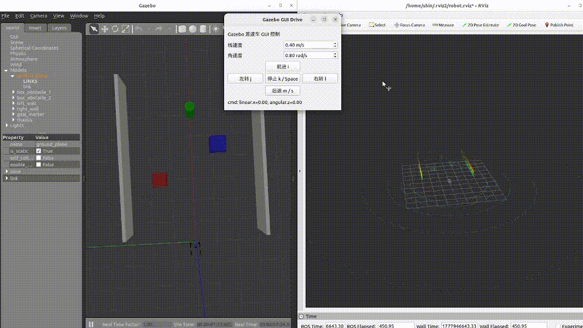
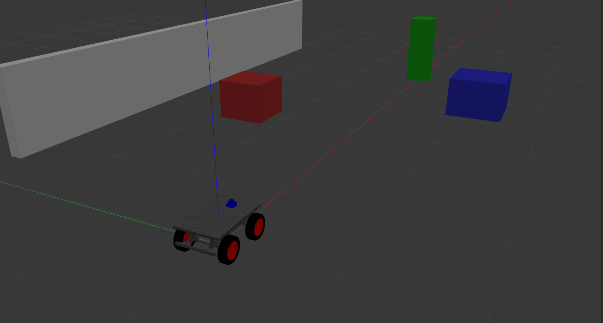
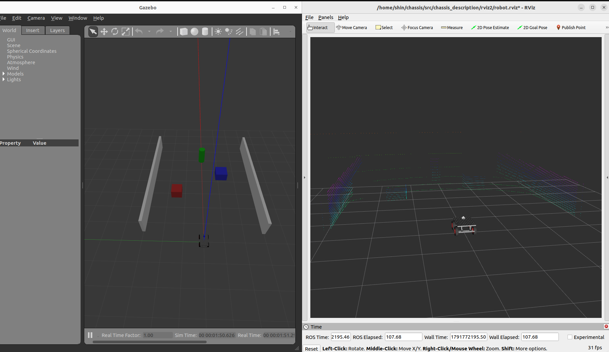

# ROS 2 Gazebo Livox Chassis Simulation

## Simulation Demo



[Watch Full Simulation Video](src/chassis_description/demo.mp4)


**Four-wheel mobile robot simulation with ROS 2 Humble, Gazebo Classic 11, RViz2, simulated LiDAR and IMU.**

This project uses a SolidWorks-derived URDF chassis with differential-drive control, simulated 360° LiDAR point clouds, IMU measurements, odometry, TF, and trajectory visualization. It includes both GUI and keyboard teleoperation for testing robot motion and ROS 2 sensor integration.

## Demo

[](src/chassis_description/demo.mp4)

**[▶ Watch the simulation demo (MP4)](src/chassis_description/demo.mp4)**

*The image links to the demonstration video. GitHub README does not automatically play local MP4 files inline.*

## Simulation Screenshots

**Gazebo — robot chassis and simulation world**


**RViz2 — robot model and sensor visualization**



## Features

- **Mobile robot:** four-wheel SolidWorks-derived chassis and Gazebo differential-drive control
- **Simulation:** Gazebo Classic 11 with a test world containing ground, walls, and obstacles
- **Sensors:** simulated 360° LiDAR point cloud and IMU
- **Livox-like visualization:** optional filtered point cloud for Livox MID-360S-like visualization
- **ROS 2 interfaces:** `/cmd_vel`, `/odom`, `/tf`, `/tf_static`, `/joint_states`, and `/path`
- **Visualization:** RViz2 robot model, point clouds, and robot trajectory
- **Teleoperation:** GUI buttons or keyboard controls

## Requirements

- Ubuntu 22.04
- ROS 2 Humble
- Gazebo Classic 11 and ROS–Gazebo packages used by the launch files
- RViz2
- Python 3; PyQt5 for the GUI controller

## Quick Start

Clone this repository into a ROS 2 workspace (the examples use `~/chassis`):

```bash
cd ~
git clone https://github.com/Fanxu2002/ros2_gazebo_livox_chassis.git chassis
cd ~/chassis
source /opt/ros/humble/setup.bash
colcon build --packages-select chassis_description --symlink-install
source install/setup.bash
```

**Launch Gazebo + RViz2 + GUI control:**

```bash
ros2 launch chassis_description gazebo_full.launch.py
```

**Or launch Gazebo + RViz2 + keyboard control:**

```bash
ros2 launch chassis_description gazebo_keyboard_full.launch.py
```

Use the controller to drive the chassis; positive `/cmd_vel.linear.x` commands motion toward the LiDAR-facing side of the robot.

> **Note:** The keyboard launch must contain valid Python indentation. If you previously encountered `IndentationError` in `gazebo_keyboard_full.launch.py`, fix that source file and rebuild before starting keyboard mode.

## Main ROS 2 Topics

| Topic | Description |
| --- | --- |
| `/cmd_vel` | Robot velocity commands |
| `/odom` | Simulated robot odometry |
| `/path` | Path generated from odometry |
| `/livox/lidar` | Original simulated LiDAR `PointCloud2` |
| `/livox/lidar_like` | Livox-like filtered point cloud for visualization |
| `/livox/imu` | Simulated IMU measurements |
| `/joint_states` | Wheel joint states for robot visualization |
| `/tf`, `/tf_static` | Dynamic and static transforms |
| `/clock` | Gazebo simulation clock |

In RViz2, select `odom` as the fixed frame, visualize `/livox/lidar_like` using **PointCloud2**, and show `/path` using **Path**. The robot model is published on `/robot_description`.

## Technical Notes

The LiDAR simulation **approximates** a Livox MID-360S-like field of view and point-cloud appearance. The Gazebo `gpu_ray` sensor does **not** reproduce the real Livox non-repetitive scanning pattern, and the optional `/livox/lidar_like` filter is intended for visualization rather than physical sensor fidelity.

The chassis uses `gazebo_ros_diff_drive` to accept velocity commands and publish odometry. A helper node estimates wheel joint angles from odometry and commands for RViz2 visualization; these joint states are not direct wheel-encoder measurements.

For LiDAR–inertial SLAM evaluation, verify point-cloud timing fields, sensor extrinsics, IMU conventions, simulation time, and the suitability of the reference trajectory before using the data quantitatively.

## Future Directions

Potential extensions include SLAM integration, Nav2-based autonomous navigation, agricultural simulation environments, and RGB-D / LiDAR–visual–inertial perception.

---

*Developed for ROS 2 mobile robotics simulation, sensor visualization, and perception-system prototyping.*
